## Simulador de escalonamento multiprocessado com paginação sob demanda

Sistemas Operacionais - Trabalho M2 | 03/11/2026

Equipe: Matheus Thurow, Rodrigo Nicola e Eduardo Bez.

Implementação em Python; 32 configurações executadas e repetidas integralmente, com resultados idênticos. Cada execução concluiu os 1.000 processos e consumiu exatamente 40.398 unidades úteis de CPU.

## Modelo e estruturas de dados

O motor avança em unidades inteiras, com CPUs simuladas e uma fila global. FCFS/RR usam deque (inserção e retirada O(1)); SJF usa heap pelo burst restante e sequência de entrada (O(log P)). Eventos usam heap por instante e pid. Cada processo mantém o índice de burst e referência, estado e acumuladores de tempo. Nenhuma política consulta o rótulo de classe.

A memória usa dicionário pelo par (pid, página), com ordem de carga, último acesso e proteção. FIFO/LRU buscam o mínimo entre páginas não protegidas (O(F), com F quadros). Acertos são O(1); liberar um processo percorre os quadros. O motor custa O(C) por tick, além dos eventos e substituições; o log opcional custa mais por registrar os conjuntos completos.

No instante t, concluem-se os bursts da unidade anterior, liberando páginas dos terminados. Entram chegadas e retornos juntos por pid; depois são tratadas preempções por índice de CPU e os despachos. As CPUs são atendidas por índice: cada uma resolve despacho e acesso antes da próxima; faults não consomem tempo e permitem outro despacho no mesmo instante. Empates de acesso são ordenados pelo índice da CPU.

A página só é carregada no retorno do fault, após 20 unidades. Retornos no mesmo instante são resolvidos por pid. Sem vítima, tenta-se novamente após 20 unidades sem somar novo fault. A proteção dura até o primeiro acesso efetivo. FIFO e LRU usam sequências totais de operações para desempatar; uma carga protegida recebe a sequência de carga como valor inicial de recência.

O contexto da CPU é identificado pelo último contexto instalado no despacho, inclusive quando o acesso seguinte produz fault. O primeiro despacho cobra troca; um retorno ao mesmo contexto sem outro despacho não cobra. Com custo zero, nenhuma ocorrência é contada como custo cobrado. Resposta e espera encerram-se no despacho, antes da troca.

## Validação e reprodução

Os testes automatizados reproduzem o exemplo 7.1 (makespan 13, útil 10, troca 3, espera 4,67 e turnaround 9), o 7.2 (fault de teste = 5, makespan 13, cinco faults, esperas zero) e o 7.3 (esperas médias 3,67 FCFS e 2,33 SJF). O exemplo 5.5 termina em 441, com quatro faults. A latência da CLI de produção permanece fixa em 20.

Também são testados RR sem concorrentes, chegada no quantum, SJF não preemptivo e empate, FIFO/LRU, quadros protegidos, retentativa sem fault extra e quatro CPUs simultâneas. Asserções em toda execução verificam: útil + troca + ocioso = makespan por CPU; turnaround = espera + útil + troca + bloqueio por processo; todas as referências consumidas e memória liberada ao terminar.

Comandos: python -m unittest discover -s tests -v; python experimentos.py; python gerar_relatorio.py. Cada diretório em resultados contém resultado.json, processos.csv, cpus.csv, gantt.csv e gantt.png. O consolidado.csv resume a matriz; ambiente.json contém hashes SHA-256, interpretador e comandos exatos. Tempos reais não são tempos simulados.

Ambiente medido: Windows-11-10.0.26200-SP0; Python 3.14.7; Intel64 Family 6 Model 151 Stepping 2, GenuineIntel. Hardware registrado: {'Name': '12th Gen Intel(R) Core(TM) i5-12450HX', 'NumberOfCores': 8, 'NumberOfLogicalProcessors': 12}. As CPUs 1/4 são simuladas sequencialmente, sem paralelismo real.

Tempo real do motor: mínimo 0.150s; máximo 8.893s. Motor + saída: máximo 10.841s. A medição do motor inclui validação e cálculo de métricas, exclui leitura do arquivo, figuras e a repetição de verificação. Todas as configurações ficaram abaixo de um minuto nesta máquina.

Matriz: FCFS, SJF e RR com Q=2,5,10,20,50; dois cenários e duas quantidades de CPUs; LRU/256 quadros/troca 1. Mais quatro casos FCFS/FIFO. O PDF lista Q=2,10,50, mas menciona cinco quantums na contagem; Q=5 e 20 ampliam a cobertura por decisão de implementação.

Taxa de faults = faults / 40.398 referências lógicas. Retentativas por falta de vítima não aumentam o numerador. Speedup = makespan 1 CPU / makespan 4 CPUs equivalentes; eficiência = speedup / 4. Percentuais por CPU incluem o intervalo desde t=0, inclusive antes da primeira chegada.

## Resultados - cenario_A_t0

Valores de tempo em unidades simuladas. Identificação: cenário-CPUs-política[-quantum]-memória. Todos os casos usam 256 quadros e custo de troca 1. Speedup e eficiência indicam o par 1/4 CPUs da mesma configuração, repetidos nas duas linhas.

| Execução | Fim | Espera média | Espera máx. | Turn. médio | Resp. média | Trocas | Faults | Taxa % | Speedup | Efic. % |
| --- | --- | --- | --- | --- | --- | --- | --- | --- | --- | --- |
| A-1CPU-FCFS-FIFO | 65613 | 11697.93 | 59408 | 25197.32 | 499.50 | 25140 | 22174 | 54.89 | 4.00 | 99.92 |
| A-1CPU-FCFS-LRU | 64665 | 11650.15 | 58710 | 25130.17 | 499.50 | 24220 | 21252 | 52.61 | 3.97 | 99.16 |
| A-1CPU-RR-Q10-LRU | 65429 | 11702.34 | 59985 | 25181.34 | 499.50 | 25031 | 21160 | 52.38 | 3.99 | 99.83 |
| A-1CPU-RR-Q20-LRU | 64834 | 11657.25 | 59111 | 25138.31 | 499.50 | 24436 | 21293 | 52.71 | 3.98 | 99.38 |
| A-1CPU-RR-Q2-LRU | 74864 | 12259.50 | 69754 | 25663.93 | 499.50 | 34466 | 20711 | 51.27 | 3.99 | 99.72 |
| A-1CPU-RR-Q50-LRU | 64653 | 11648.85 | 58797 | 25128.89 | 499.50 | 24230 | 21252 | 52.61 | 3.97 | 99.25 |
| A-1CPU-RR-Q5-LRU | 67309 | 11776.18 | 62094 | 25253.83 | 499.50 | 26911 | 20999 | 51.98 | 4.00 | 99.89 |
| A-1CPU-SJF-LRU | 50931 | 14319.05 | 49813 | 14551.13 | 7257.21 | 10299 | 7335 | 18.16 | 3.81 | 95.31 |
| A-4CPU-FCFS-FIFO | 16417 | 2746.78 | 11658 | 6324.19 | 124.50 | 24785 | 21821 | 54.02 | 4.00 | 99.92 |
| A-4CPU-FCFS-LRU | 16303 | 2752.89 | 11798 | 6310.10 | 124.50 | 23827 | 20861 | 51.64 | 3.97 | 99.16 |
| A-4CPU-RR-Q10-LRU | 16385 | 2763.79 | 12045 | 6319.08 | 124.50 | 24572 | 20728 | 51.31 | 3.99 | 99.83 |
| A-4CPU-RR-Q20-LRU | 16310 | 2754.30 | 11809 | 6310.76 | 124.50 | 23940 | 20818 | 51.53 | 3.98 | 99.38 |
| A-4CPU-RR-Q2-LRU | 18769 | 2904.74 | 14451 | 6462.01 | 124.50 | 34166 | 20540 | 50.84 | 3.99 | 99.72 |
| A-4CPU-RR-Q50-LRU | 16286 | 2752.66 | 11786 | 6309.41 | 124.50 | 23808 | 20839 | 51.58 | 3.97 | 99.25 |
| A-4CPU-RR-Q5-LRU | 16845 | 2782.86 | 12620 | 6337.50 | 124.50 | 26510 | 20598 | 50.99 | 4.00 | 99.89 |
| A-4CPU-SJF-LRU | 13359 | 3466.59 | 12239 | 3713.98 | 1771.17 | 11029 | 8064 | 19.96 | 3.81 | 95.31 |

## Resultados - cenario_B_espacadas

Valores de tempo em unidades simuladas. Identificação: cenário-CPUs-política[-quantum]-memória. Todos os casos usam 256 quadros e custo de troca 1. Speedup e eficiência indicam o par 1/4 CPUs da mesma configuração, repetidos nas duas linhas.

| Execução | Fim | Espera média | Espera máx. | Turn. médio | Resp. média | Trocas | Faults | Taxa % | Speedup | Efic. % |
| --- | --- | --- | --- | --- | --- | --- | --- | --- | --- | --- |
| B-1CPU-FCFS-FIFO | 64863 | 11009.08 | 58236 | 19058.95 | 493.21 | 24392 | 21425 | 53.03 | 4.79 | 119.75 |
| B-1CPU-FCFS-LRU | 63989 | 10991.44 | 57383 | 18995.48 | 493.19 | 23539 | 20570 | 50.92 | 4.77 | 119.20 |
| B-1CPU-RR-Q10-LRU | 64685 | 11030.26 | 58785 | 19031.95 | 493.19 | 24286 | 20415 | 50.53 | 4.68 | 117.06 |
| B-1CPU-RR-Q20-LRU | 64114 | 11000.11 | 57362 | 19004.45 | 493.19 | 23715 | 20576 | 50.93 | 4.70 | 117.49 |
| B-1CPU-RR-Q2-LRU | 74688 | 11744.28 | 69129 | 20126.98 | 490.66 | 34289 | 20215 | 50.04 | 4.21 | 105.35 |
| B-1CPU-RR-Q50-LRU | 63965 | 10989.91 | 57209 | 18994.09 | 493.19 | 23555 | 20576 | 50.93 | 4.73 | 118.13 |
| B-1CPU-RR-Q5-LRU | 66667 | 11144.34 | 61295 | 19161.31 | 493.76 | 26268 | 20327 | 50.32 | 4.60 | 114.92 |
| B-1CPU-SJF-LRU | 50437 | 8606.07 | 47210 | 8828.28 | 3423.16 | 9830 | 6865 | 16.99 | 3.93 | 98.18 |
| B-4CPU-FCFS-FIFO | 13541 | 466.44 | 5944 | 741.28 | 37.13 | 12332 | 9371 | 23.20 | 4.79 | 119.75 |
| B-4CPU-FCFS-LRU | 13421 | 527.24 | 5959 | 799.81 | 41.97 | 12225 | 9263 | 22.93 | 4.77 | 119.20 |
| B-4CPU-RR-Q10-LRU | 13814 | 512.07 | 6560 | 791.23 | 36.07 | 13623 | 9523 | 23.57 | 4.68 | 117.06 |
| B-4CPU-RR-Q20-LRU | 13642 | 525.12 | 6328 | 805.46 | 38.87 | 12910 | 9617 | 23.81 | 4.70 | 117.49 |
| B-4CPU-RR-Q2-LRU | 17723 | 855.18 | 11110 | 1202.58 | 31.34 | 29557 | 12138 | 30.05 | 4.21 | 105.35 |
| B-4CPU-RR-Q50-LRU | 13537 | 523.81 | 6127 | 799.84 | 40.04 | 12443 | 9425 | 23.33 | 4.73 | 118.13 |
| B-4CPU-RR-Q5-LRU | 14503 | 532.82 | 7790 | 821.07 | 32.00 | 16508 | 9833 | 24.34 | 4.60 | 114.92 |
| B-4CPU-SJF-LRU | 12843 | 165.36 | 8786 | 365.04 | 19.36 | 8755 | 5792 | 14.34 | 3.93 | 98.18 |

## Espera e efeito do quantum

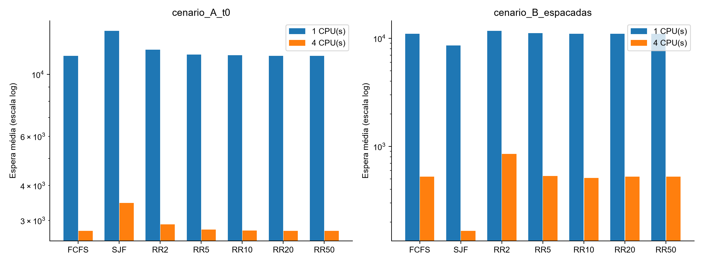

A escala logarítmica permite comparar os cenários; use os valores absolutos das tabelas para quantificar as diferenças. Os gráficos mostram apenas a base LRU.

## Efeito do quantum no Round Robin

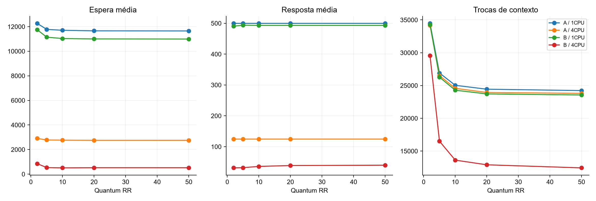

## Speedup e evidências

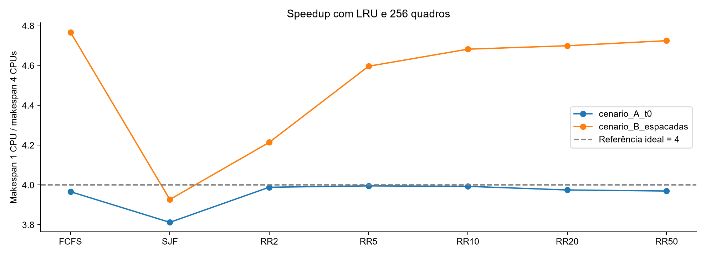

A-4CPU-FCFS-LRU versus A-4CPU-SJF-LRU: espera média 2752.89 versus 3466.59; makespan 16303 versus 13359; faults 20861 versus 8064. A mudança conjunta de fila e referências impede atribuir a diferença apenas à escolha do menor burst. O comportamento é compatível com a redução de atrasos causados por bursts longos no FCFS, sem isolar causalmente o efeito comboio.

A-4CPU-RR-Q2-LRU versus A-4CPU-RR-Q50-LRU: Q=2/50 produz resposta média 124.50/124.50, espera média 2904.74/2752.66 e 34166/23808 trocas. Esses dados mostram o compromisso observado entre atendimento inicial e custo, que também é afetado pelos faults.

B-4CPU-FCFS-LRU versus B-4CPU-SJF-LRU: espera média 527.24 versus 165.36; makespan 13421 versus 12843; faults 9263 versus 5792. A mudança conjunta de fila e referências impede atribuir a diferença apenas à escolha do menor burst. O comportamento é compatível com a redução de atrasos causados por bursts longos no FCFS, sem isolar causalmente o efeito comboio.

B-4CPU-RR-Q2-LRU versus B-4CPU-RR-Q50-LRU: Q=2/50 produz resposta média 31.34/40.04, espera média 855.18/523.81 e 29557/12443 trocas. Esses dados mostram o compromisso observado entre atendimento inicial e custo, que também é afetado pelos faults.

O cenário B impõe chegadas até 10.604; CPUs extras não antecipam chegadas. Portanto, o speedup inclui limites de chegada, bloqueios e diferenças de memória, além da capacidade de CPU. Quatro é uma referência ideal, não uma garantia para este modelo integrado.

B-4CPU-FCFS-FIFO apresenta speedup 4.79 e eficiência 119.75%, acima da referência linear. As execuções de 1/4 CPUs têm 21425/9371 faults: a ordem de execução altera a pressão na memória. O ganho medido abrange essa interação e não representa paralelização de uma sequência fixa de instruções e faltas.

## Leitura dos Gantts de 1 e 4 CPUs

A-1CPU-FCFS-LRU, janela [0,200): soma entre CPUs de 0 unidades úteis, 200 de troca e 0 ociosas. São parcelas da janela, distintas dos totais da execução no apêndice.

B-4CPU-FCFS-LRU, janela [0,200): soma entre CPUs de 434 unidades úteis, 287 de troca e 79 ociosas. São parcelas da janela, distintas dos totais da execução no apêndice.

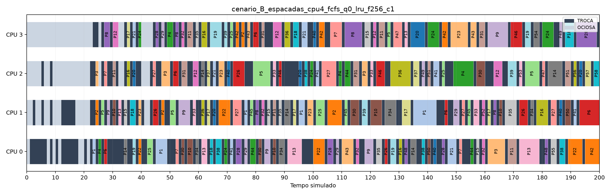

No cenário A/FCFS, a fila inicial de 1.000 processos faz a janela inicial ser dominada por instalação de contextos e primeiras faltas: mesmo ocupada, a CPU ainda não produz trabalho útil. No cenário B com 4 CPUs, chegadas espaçadas permitem retornos atendidos mais cedo; aparecem intervalos úteis e ociosos. O Gantt evidencia por que utilização que inclui troca não equivale a produtividade.

## Comparação de memória e justiça

A-1CPU-FCFS-FIFO comparado a A-1CPU-FCFS-LRU: diferença FIFO - LRU de +922 faults e +948 unidades de makespan. A comparação preserva cenário, escalonador, CPUs, quadros e custo.

A-4CPU-FCFS-FIFO comparado a A-4CPU-FCFS-LRU: diferença FIFO - LRU de +960 faults e +114 unidades de makespan. A comparação preserva cenário, escalonador, CPUs, quadros e custo.

B-1CPU-FCFS-FIFO comparado a B-1CPU-FCFS-LRU: diferença FIFO - LRU de +855 faults e +874 unidades de makespan. A comparação preserva cenário, escalonador, CPUs, quadros e custo.

B-4CPU-FCFS-FIFO comparado a B-4CPU-FCFS-LRU: diferença FIFO - LRU de +108 faults e +120 unidades de makespan. A comparação preserva cenário, escalonador, CPUs, quadros e custo.

| FIFO (par com LRU) | Faults FIFO | Faults LRU | Fim FIFO | Fim LRU | Espera FIFO | Espera LRU |
| --- | --- | --- | --- | --- | --- | --- |
| A-1CPU-FCFS-FIFO | 22174 | 21252 | 65613 | 64665 | 11697.93 | 11650.15 |
| A-4CPU-FCFS-FIFO | 21821 | 20861 | 16417 | 16303 | 2746.78 | 2752.89 |
| B-1CPU-FCFS-FIFO | 21425 | 20570 | 64863 | 63989 | 11009.08 | 10991.44 |
| B-4CPU-FCFS-FIFO | 9371 | 9263 | 13541 | 13421 | 466.44 | 527.24 |

Faults frequentes, isoladamente, não provam thrashing: faltas compulsórias e localidade também pesam. São registrados substituições e retentativas, mas não uma série temporal de conjunto de trabalho. A análise não declara thrashing sem essa evidência adicional.

Todos os processos terminaram nas cargas finitas. Isso exclui inanição observada nestas execuções, mas não prova ausência de starvation para chegadas ilimitadas no SJF. A tabela seguinte separa classes somente na análise; espera é o tempo acumulado na fila, não tempo total de bloqueio.

## Justiça por classe - cenario_A_t0

| Execução | Média curtos (952) | Máx. curtos | Média longos (48) | Máx. longos |
| --- | --- | --- | --- | --- |
| A-1CPU-FCFS-FIFO | 9923.87 | 21882 | 46883.62 | 59408 |
| A-1CPU-FCFS-LRU | 9924.63 | 21882 | 45872.88 | 58710 |
| A-1CPU-RR-Q10-LRU | 9922.76 | 21882 | 46997.40 | 59985 |
| A-1CPU-RR-Q20-LRU | 9924.54 | 21882 | 46022.60 | 59111 |
| A-1CPU-RR-Q2-LRU | 10083.33 | 22028 | 55420.10 | 69754 |
| A-1CPU-RR-Q50-LRU | 9924.62 | 21882 | 45846.12 | 58797 |
| A-1CPU-RR-Q5-LRU | 9918.81 | 21882 | 48613.85 | 62094 |
| A-1CPU-SJF-LRU | 13115.11 | 24202 | 38197.06 | 49813 |
| A-4CPU-FCFS-FIFO | 2425.47 | 5402 | 9119.42 | 11658 |
| A-4CPU-FCFS-LRU | 2426.62 | 5405 | 9223.75 | 11798 |
| A-4CPU-RR-Q10-LRU | 2426.33 | 5405 | 9456.75 | 12045 |
| A-4CPU-RR-Q20-LRU | 2426.62 | 5405 | 9253.31 | 11809 |
| A-4CPU-RR-Q2-LRU | 2468.96 | 5413 | 11547.85 | 14451 |
| A-4CPU-RR-Q50-LRU | 2426.62 | 5405 | 9219 | 11786 |
| A-4CPU-RR-Q5-LRU | 2425.38 | 5405 | 9872.85 | 12620 |
| A-4CPU-SJF-LRU | 3187.04 | 5991 | 9010.96 | 12239 |

Com 4 CPUs/LRU, A-4CPU-FCFS-LRU e A-4CPU-SJF-LRU produzem espera média dos curtos de 2426.62/3187.04, e dos longos de 9223.75/9010.96. A separação mostra que a média global não descreve igualmente as duas classes. A espera acumulada não é normalizada pela demanda de CPU; processos longos têm mais oportunidades de retornar à fila, portanto valores maiores não demonstram, por si só, tratamento injusto por despacho.

## Justiça por classe - cenario_B_espacadas

| Execução | Média curtos (952) | Máx. curtos | Média longos (48) | Máx. longos |
| --- | --- | --- | --- | --- |
| B-1CPU-FCFS-FIFO | 9235.91 | 22146 | 46176.94 | 58236 |
| B-1CPU-FCFS-LRU | 9246.34 | 21994 | 45602.67 | 57383 |
| B-1CPU-RR-Q10-LRU | 9243.53 | 21994 | 46467.15 | 58785 |
| B-1CPU-RR-Q20-LRU | 9246.29 | 21994 | 45784.27 | 57362 |
| B-1CPU-RR-Q2-LRU | 9568.48 | 22577 | 54897.79 | 69129 |
| B-1CPU-RR-Q50-LRU | 9246.33 | 21994 | 45570.94 | 57209 |
| B-1CPU-RR-Q5-LRU | 9279.97 | 22123 | 48121 | 61295 |
| B-1CPU-SJF-LRU | 7372.95 | 23682 | 33062.96 | 47210 |
| B-4CPU-FCFS-FIFO | 331.01 | 804 | 3152.60 | 5944 |
| B-4CPU-FCFS-LRU | 393.76 | 1168 | 3174.75 | 5959 |
| B-4CPU-RR-Q10-LRU | 347.57 | 1073 | 3774.60 | 6560 |
| B-4CPU-RR-Q20-LRU | 377.76 | 1140 | 3447.81 | 6328 |
| B-4CPU-RR-Q2-LRU | 494.88 | 1580 | 8001.17 | 11110 |
| B-4CPU-RR-Q50-LRU | 385.91 | 1063 | 3258.90 | 6127 |
| B-4CPU-RR-Q5-LRU | 323.83 | 972 | 4677.88 | 7790 |
| B-4CPU-SJF-LRU | 36.80 | 318 | 2715.12 | 8786 |

Com 4 CPUs/LRU, B-4CPU-FCFS-LRU e B-4CPU-SJF-LRU produzem espera média dos curtos de 393.76/36.80, e dos longos de 3174.75/2715.12. A separação mostra que a média global não descreve igualmente as duas classes. A espera acumulada não é normalizada pela demanda de CPU; processos longos têm mais oportunidades de retornar à fila, portanto valores maiores não demonstram, por si só, tratamento injusto por despacho.

## Limitações e entrega

SJF conhece o burst futuro; um SO real o estimaria. Não há fila de disco, custo de migração, cache, TLB, bytes, endereços ou paralelismo físico. Latências de E/S e fault são independentes e constantes conforme o modelo. A ordem de operações simultâneas e a instalação de contexto são convenções determinísticas documentadas, relevantes à reprodução.

Os critérios complementares do AVA não foram consultados: não há acesso autenticado disponibilizado. O prazo do PDF é 03/11/2026 às 19h. Repositório de destino informado pela equipe: https://github.com/MatheusThurow/SO_m2. O estado da publicação está registrado em STATUS.md. O envio ao AVA continua pendente; publicação no GitHub não constitui submissão ao AVA.

Defesa: demonstrar a CLI com --cpus 1/4, --sched fcfs/sjf/rr, --quantum 2/50, --quadros 1/256 e --subst fifo/lru; usar o exemplo pequeno com --log; explicar a proteção no retorno, consumo de referências, fila global, resposta antes da troca e identidades de conservação de tempo. Consulte DEFESA.md para o roteiro completo.

## Apêndice - Gantts e tempos por CPU

Cada página seguinte identifica uma configuração e mostra a janela 0 a 200. Pn identifica o processo; TROCA e OCIOSA usam a legenda. Os CSVs preservam exatamente cada intervalo e permitem ampliar qualquer trecho. A tabela abaixo de cada figura cobre toda a execução, e não apenas a janela do gráfico.

## A-1CPU-FCFS-FIFO

cenario_A_t0_cpu1_fcfs_q0_fifo_f256_c1

| CPU | Útil | Útil % | Troca | Troca % | Ocioso | Ocioso % | Trocas | Utilização % |
| --- | --- | --- | --- | --- | --- | --- | --- | --- |
| 0 | 40398 | 61.57 | 25140 | 38.32 | 75 | 0.11 | 25140 | 99.89 |

Makespan 65613; espera média 11697.93; resposta média 499.50; faults 22174; taxa 54.89%.

## A-1CPU-FCFS-LRU

cenario_A_t0_cpu1_fcfs_q0_lru_f256_c1

| CPU | Útil | Útil % | Troca | Troca % | Ocioso | Ocioso % | Trocas | Utilização % |
| --- | --- | --- | --- | --- | --- | --- | --- | --- |
| 0 | 40398 | 62.47 | 24220 | 37.45 | 47 | 0.07 | 24220 | 99.93 |

Makespan 64665; espera média 11650.15; resposta média 499.50; faults 21252; taxa 52.61%.

## A-1CPU-RR-Q10-LRU

cenario_A_t0_cpu1_rr_q10_lru_f256_c1

| CPU | Útil | Útil % | Troca | Troca % | Ocioso | Ocioso % | Trocas | Utilização % |
| --- | --- | --- | --- | --- | --- | --- | --- | --- |
| 0 | 40398 | 61.74 | 25031 | 38.26 | 0 | 0.00 | 25031 | 100.00 |

Makespan 65429; espera média 11702.34; resposta média 499.50; faults 21160; taxa 52.38%.

## A-1CPU-RR-Q20-LRU

cenario_A_t0_cpu1_rr_q20_lru_f256_c1

| CPU | Útil | Útil % | Troca | Troca % | Ocioso | Ocioso % | Trocas | Utilização % |
| --- | --- | --- | --- | --- | --- | --- | --- | --- |
| 0 | 40398 | 62.31 | 24436 | 37.69 | 0 | 0.00 | 24436 | 100.00 |

Makespan 64834; espera média 11657.25; resposta média 499.50; faults 21293; taxa 52.71%.

## A-1CPU-RR-Q2-LRU

cenario_A_t0_cpu1_rr_q2_lru_f256_c1

| CPU | Útil | Útil % | Troca | Troca % | Ocioso | Ocioso % | Trocas | Utilização % |
| --- | --- | --- | --- | --- | --- | --- | --- | --- |
| 0 | 40398 | 53.96 | 34466 | 46.04 | 0 | 0.00 | 34466 | 100.00 |

Makespan 74864; espera média 12259.50; resposta média 499.50; faults 20711; taxa 51.27%.

## A-1CPU-RR-Q50-LRU

cenario_A_t0_cpu1_rr_q50_lru_f256_c1

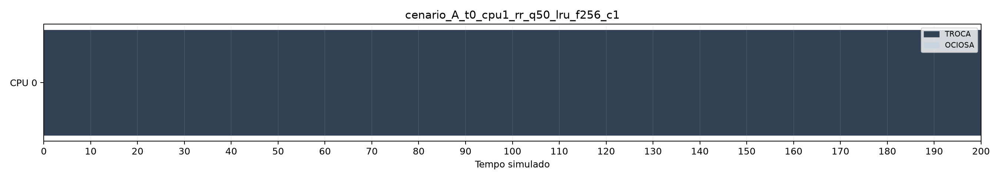

| CPU | Útil | Útil % | Troca | Troca % | Ocioso | Ocioso % | Trocas | Utilização % |
| --- | --- | --- | --- | --- | --- | --- | --- | --- |
| 0 | 40398 | 62.48 | 24230 | 37.48 | 25 | 0.04 | 24230 | 99.96 |

Makespan 64653; espera média 11648.85; resposta média 499.50; faults 21252; taxa 52.61%.

## A-1CPU-RR-Q5-LRU

cenario_A_t0_cpu1_rr_q5_lru_f256_c1

| CPU | Útil | Útil % | Troca | Troca % | Ocioso | Ocioso % | Trocas | Utilização % |
| --- | --- | --- | --- | --- | --- | --- | --- | --- |
| 0 | 40398 | 60.02 | 26911 | 39.98 | 0 | 0.00 | 26911 | 100.00 |

Makespan 67309; espera média 11776.18; resposta média 499.50; faults 20999; taxa 51.98%.

## A-1CPU-SJF-LRU

cenario_A_t0_cpu1_sjf_q0_lru_f256_c1

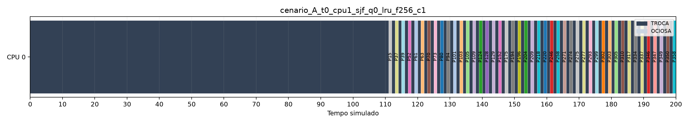

| CPU | Útil | Útil % | Troca | Troca % | Ocioso | Ocioso % | Trocas | Utilização % |
| --- | --- | --- | --- | --- | --- | --- | --- | --- |
| 0 | 40398 | 79.32 | 10299 | 20.22 | 234 | 0.46 | 10299 | 99.54 |

Makespan 50931; espera média 14319.05; resposta média 7257.21; faults 7335; taxa 18.16%.

## A-4CPU-FCFS-FIFO

cenario_A_t0_cpu4_fcfs_q0_fifo_f256_c1

| CPU | Útil | Útil % | Troca | Troca % | Ocioso | Ocioso % | Trocas | Utilização % |
| --- | --- | --- | --- | --- | --- | --- | --- | --- |
| 0 | 10167 | 61.93 | 6148 | 37.45 | 102 | 0.62 | 6148 | 99.38 |
| 1 | 10138 | 61.75 | 6174 | 37.61 | 105 | 0.64 | 6174 | 99.36 |
| 2 | 10105 | 61.55 | 6204 | 37.79 | 108 | 0.66 | 6204 | 99.34 |
| 3 | 9988 | 60.84 | 6259 | 38.13 | 170 | 1.04 | 6259 | 98.96 |

Makespan 16417; espera média 2746.78; resposta média 124.50; faults 21821; taxa 54.02%.

## A-4CPU-FCFS-LRU

cenario_A_t0_cpu4_fcfs_q0_lru_f256_c1

| CPU | Útil | Útil % | Troca | Troca % | Ocioso | Ocioso % | Trocas | Utilização % |
| --- | --- | --- | --- | --- | --- | --- | --- | --- |
| 0 | 10199 | 62.56 | 6016 | 36.90 | 88 | 0.54 | 6016 | 99.46 |
| 1 | 10134 | 62.16 | 5938 | 36.42 | 231 | 1.42 | 5938 | 98.58 |
| 2 | 9972 | 61.17 | 5960 | 36.56 | 371 | 2.28 | 5960 | 97.72 |
| 3 | 10093 | 61.91 | 5913 | 36.27 | 297 | 1.82 | 5913 | 98.18 |

Makespan 16303; espera média 2752.89; resposta média 124.50; faults 20861; taxa 51.64%.

## A-4CPU-RR-Q10-LRU

cenario_A_t0_cpu4_rr_q10_lru_f256_c1

| CPU | Útil | Útil % | Troca | Troca % | Ocioso | Ocioso % | Trocas | Utilização % |
| --- | --- | --- | --- | --- | --- | --- | --- | --- |
| 0 | 10145 | 61.92 | 6139 | 37.47 | 101 | 0.62 | 6139 | 99.38 |
| 1 | 10100 | 61.64 | 6154 | 37.56 | 131 | 0.80 | 6154 | 99.20 |
| 2 | 10036 | 61.25 | 6161 | 37.60 | 188 | 1.15 | 6161 | 98.85 |
| 3 | 10117 | 61.75 | 6118 | 37.34 | 150 | 0.92 | 6118 | 99.08 |

Makespan 16385; espera média 2763.79; resposta média 124.50; faults 20728; taxa 51.31%.

## A-4CPU-RR-Q20-LRU

cenario_A_t0_cpu4_rr_q20_lru_f256_c1

| CPU | Útil | Útil % | Troca | Troca % | Ocioso | Ocioso % | Trocas | Utilização % |
| --- | --- | --- | --- | --- | --- | --- | --- | --- |
| 0 | 10171 | 62.36 | 6006 | 36.82 | 133 | 0.82 | 6006 | 99.18 |
| 1 | 10083 | 61.82 | 5972 | 36.62 | 255 | 1.56 | 5972 | 98.44 |
| 2 | 10111 | 61.99 | 5961 | 36.55 | 238 | 1.46 | 5961 | 98.54 |
| 3 | 10033 | 61.51 | 6001 | 36.79 | 276 | 1.69 | 6001 | 98.31 |

Makespan 16310; espera média 2754.30; resposta média 124.50; faults 20818; taxa 51.53%.

## A-4CPU-RR-Q2-LRU

cenario_A_t0_cpu4_rr_q2_lru_f256_c1

| CPU | Útil | Útil % | Troca | Troca % | Ocioso | Ocioso % | Trocas | Utilização % |
| --- | --- | --- | --- | --- | --- | --- | --- | --- |
| 0 | 10160 | 54.13 | 8530 | 45.45 | 79 | 0.42 | 8530 | 99.58 |
| 1 | 10160 | 54.13 | 8555 | 45.58 | 54 | 0.29 | 8555 | 99.71 |
| 2 | 10061 | 53.60 | 8539 | 45.50 | 169 | 0.90 | 8539 | 99.10 |
| 3 | 10017 | 53.37 | 8542 | 45.51 | 210 | 1.12 | 8542 | 98.88 |

Makespan 18769; espera média 2904.74; resposta média 124.50; faults 20540; taxa 50.84%.

## A-4CPU-RR-Q50-LRU

cenario_A_t0_cpu4_rr_q50_lru_f256_c1

| CPU | Útil | Útil % | Troca | Troca % | Ocioso | Ocioso % | Trocas | Utilização % |
| --- | --- | --- | --- | --- | --- | --- | --- | --- |
| 0 | 10145 | 62.29 | 6030 | 37.03 | 111 | 0.68 | 6030 | 99.32 |
| 1 | 10209 | 62.69 | 5924 | 36.37 | 153 | 0.94 | 5924 | 99.06 |
| 2 | 10087 | 61.94 | 5912 | 36.30 | 287 | 1.76 | 5912 | 98.24 |
| 3 | 9957 | 61.14 | 5942 | 36.49 | 387 | 2.38 | 5942 | 97.62 |

Makespan 16286; espera média 2752.66; resposta média 124.50; faults 20839; taxa 51.58%.

## A-4CPU-RR-Q5-LRU

cenario_A_t0_cpu4_rr_q5_lru_f256_c1

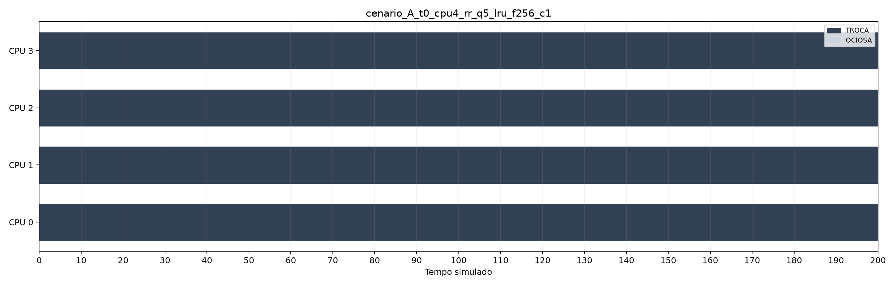

| CPU | Útil | Útil % | Troca | Troca % | Ocioso | Ocioso % | Trocas | Utilização % |
| --- | --- | --- | --- | --- | --- | --- | --- | --- |
| 0 | 10122 | 60.09 | 6660 | 39.54 | 63 | 0.37 | 6660 | 99.63 |
| 1 | 10155 | 60.28 | 6611 | 39.25 | 79 | 0.47 | 6611 | 99.53 |
| 2 | 10030 | 59.54 | 6643 | 39.44 | 172 | 1.02 | 6643 | 98.98 |
| 3 | 10091 | 59.91 | 6596 | 39.16 | 158 | 0.94 | 6596 | 99.06 |

Makespan 16845; espera média 2782.86; resposta média 124.50; faults 20598; taxa 50.99%.

## A-4CPU-SJF-LRU

cenario_A_t0_cpu4_sjf_q0_lru_f256_c1

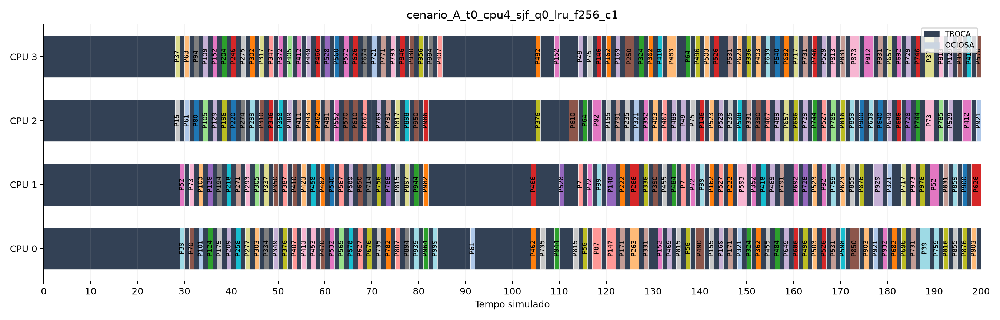

| CPU | Útil | Útil % | Troca | Troca % | Ocioso | Ocioso % | Trocas | Utilização % |
| --- | --- | --- | --- | --- | --- | --- | --- | --- |
| 0 | 10550 | 78.97 | 2641 | 19.77 | 168 | 1.26 | 2641 | 98.74 |
| 1 | 10036 | 75.13 | 2785 | 20.85 | 538 | 4.03 | 2785 | 95.97 |
| 2 | 10033 | 75.10 | 2737 | 20.49 | 589 | 4.41 | 2737 | 95.59 |
| 3 | 9779 | 73.20 | 2866 | 21.45 | 714 | 5.34 | 2866 | 94.66 |

Makespan 13359; espera média 3466.59; resposta média 1771.17; faults 8064; taxa 19.96%.

## B-1CPU-FCFS-FIFO

cenario_B_espacadas_cpu1_fcfs_q0_fifo_f256_c1

| CPU | Útil | Útil % | Troca | Troca % | Ocioso | Ocioso % | Trocas | Utilização % |
| --- | --- | --- | --- | --- | --- | --- | --- | --- |
| 0 | 40398 | 62.28 | 24392 | 37.61 | 73 | 0.11 | 24392 | 99.89 |

Makespan 64863; espera média 11009.08; resposta média 493.21; faults 21425; taxa 53.03%.

## B-1CPU-FCFS-LRU

cenario_B_espacadas_cpu1_fcfs_q0_lru_f256_c1

| CPU | Útil | Útil % | Troca | Troca % | Ocioso | Ocioso % | Trocas | Utilização % |
| --- | --- | --- | --- | --- | --- | --- | --- | --- |
| 0 | 40398 | 63.13 | 23539 | 36.79 | 52 | 0.08 | 23539 | 99.92 |

Makespan 63989; espera média 10991.44; resposta média 493.19; faults 20570; taxa 50.92%.

## B-1CPU-RR-Q10-LRU

cenario_B_espacadas_cpu1_rr_q10_lru_f256_c1

| CPU | Útil | Útil % | Troca | Troca % | Ocioso | Ocioso % | Trocas | Utilização % |
| --- | --- | --- | --- | --- | --- | --- | --- | --- |
| 0 | 40398 | 62.45 | 24286 | 37.55 | 1 | 0.00 | 24286 | 100.00 |

Makespan 64685; espera média 11030.26; resposta média 493.19; faults 20415; taxa 50.53%.

## B-1CPU-RR-Q20-LRU

cenario_B_espacadas_cpu1_rr_q20_lru_f256_c1

| CPU | Útil | Útil % | Troca | Troca % | Ocioso | Ocioso % | Trocas | Utilização % |
| --- | --- | --- | --- | --- | --- | --- | --- | --- |
| 0 | 40398 | 63.01 | 23715 | 36.99 | 1 | 0.00 | 23715 | 100.00 |

Makespan 64114; espera média 11000.11; resposta média 493.19; faults 20576; taxa 50.93%.

## B-1CPU-RR-Q2-LRU

cenario_B_espacadas_cpu1_rr_q2_lru_f256_c1

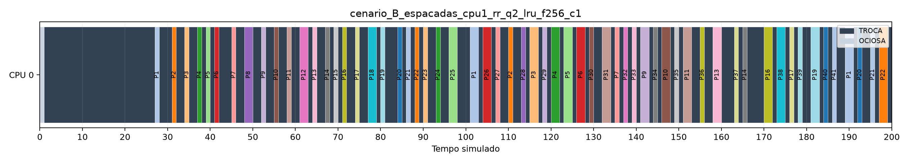

| CPU | Útil | Útil % | Troca | Troca % | Ocioso | Ocioso % | Trocas | Utilização % |
| --- | --- | --- | --- | --- | --- | --- | --- | --- |
| 0 | 40398 | 54.09 | 34289 | 45.91 | 1 | 0.00 | 34289 | 100.00 |

Makespan 74688; espera média 11744.28; resposta média 490.66; faults 20215; taxa 50.04%.

## B-1CPU-RR-Q50-LRU

cenario_B_espacadas_cpu1_rr_q50_lru_f256_c1

| CPU | Útil | Útil % | Troca | Troca % | Ocioso | Ocioso % | Trocas | Utilização % |
| --- | --- | --- | --- | --- | --- | --- | --- | --- |
| 0 | 40398 | 63.16 | 23555 | 36.82 | 12 | 0.02 | 23555 | 99.98 |

Makespan 63965; espera média 10989.91; resposta média 493.19; faults 20576; taxa 50.93%.

## B-1CPU-RR-Q5-LRU

cenario_B_espacadas_cpu1_rr_q5_lru_f256_c1

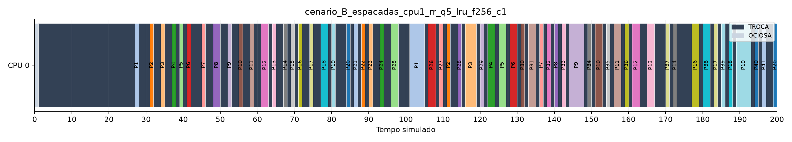

| CPU | Útil | Útil % | Troca | Troca % | Ocioso | Ocioso % | Trocas | Utilização % |
| --- | --- | --- | --- | --- | --- | --- | --- | --- |
| 0 | 40398 | 60.60 | 26268 | 39.40 | 1 | 0.00 | 26268 | 100.00 |

Makespan 66667; espera média 11144.34; resposta média 493.76; faults 20327; taxa 50.32%.

## B-1CPU-SJF-LRU

cenario_B_espacadas_cpu1_sjf_q0_lru_f256_c1

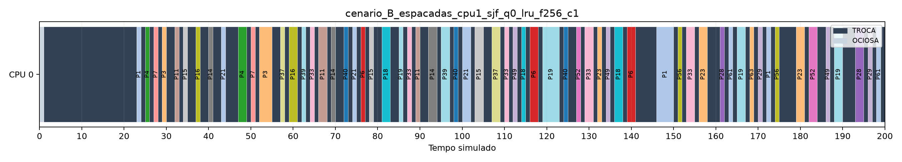

| CPU | Útil | Útil % | Troca | Troca % | Ocioso | Ocioso % | Trocas | Utilização % |
| --- | --- | --- | --- | --- | --- | --- | --- | --- |
| 0 | 40398 | 80.10 | 9830 | 19.49 | 209 | 0.41 | 9830 | 99.59 |

Makespan 50437; espera média 8606.07; resposta média 3423.16; faults 6865; taxa 16.99%.

## B-4CPU-FCFS-FIFO

cenario_B_espacadas_cpu4_fcfs_q0_fifo_f256_c1

| CPU | Útil | Útil % | Troca | Troca % | Ocioso | Ocioso % | Trocas | Utilização % |
| --- | --- | --- | --- | --- | --- | --- | --- | --- |
| 0 | 10178 | 75.16 | 3097 | 22.87 | 266 | 1.96 | 3097 | 98.04 |
| 1 | 10086 | 74.48 | 3125 | 23.08 | 330 | 2.44 | 3125 | 97.56 |
| 2 | 10254 | 75.73 | 2992 | 22.10 | 295 | 2.18 | 2992 | 97.82 |
| 3 | 9880 | 72.96 | 3118 | 23.03 | 543 | 4.01 | 3118 | 95.99 |

Makespan 13541; espera média 466.44; resposta média 37.13; faults 9371; taxa 23.20%.

## B-4CPU-FCFS-LRU

cenario_B_espacadas_cpu4_fcfs_q0_lru_f256_c1

| CPU | Útil | Útil % | Troca | Troca % | Ocioso | Ocioso % | Trocas | Utilização % |
| --- | --- | --- | --- | --- | --- | --- | --- | --- |
| 0 | 10257 | 76.43 | 3103 | 23.12 | 61 | 0.45 | 3103 | 99.55 |
| 1 | 10132 | 75.49 | 3090 | 23.02 | 199 | 1.48 | 3090 | 98.52 |
| 2 | 10032 | 74.75 | 2994 | 22.31 | 395 | 2.94 | 2994 | 97.06 |
| 3 | 9977 | 74.34 | 3038 | 22.64 | 406 | 3.03 | 3038 | 96.97 |

Makespan 13421; espera média 527.24; resposta média 41.97; faults 9263; taxa 22.93%.

## B-4CPU-RR-Q10-LRU

cenario_B_espacadas_cpu4_rr_q10_lru_f256_c1

| CPU | Útil | Útil % | Troca | Troca % | Ocioso | Ocioso % | Trocas | Utilização % |
| --- | --- | --- | --- | --- | --- | --- | --- | --- |
| 0 | 10245 | 74.16 | 3444 | 24.93 | 125 | 0.90 | 3444 | 99.10 |
| 1 | 10113 | 73.21 | 3413 | 24.71 | 288 | 2.08 | 3413 | 97.92 |
| 2 | 10101 | 73.12 | 3379 | 24.46 | 334 | 2.42 | 3379 | 97.58 |
| 3 | 9939 | 71.95 | 3387 | 24.52 | 488 | 3.53 | 3387 | 96.47 |

Makespan 13814; espera média 512.07; resposta média 36.07; faults 9523; taxa 23.57%.

## B-4CPU-RR-Q20-LRU

cenario_B_espacadas_cpu4_rr_q20_lru_f256_c1

| CPU | Útil | Útil % | Troca | Troca % | Ocioso | Ocioso % | Trocas | Utilização % |
| --- | --- | --- | --- | --- | --- | --- | --- | --- |
| 0 | 10195 | 74.73 | 3198 | 23.44 | 249 | 1.83 | 3198 | 98.17 |
| 1 | 10199 | 74.76 | 3275 | 24.01 | 168 | 1.23 | 3275 | 98.77 |
| 2 | 10025 | 73.49 | 3223 | 23.63 | 394 | 2.89 | 3223 | 97.11 |
| 3 | 9979 | 73.15 | 3214 | 23.56 | 449 | 3.29 | 3214 | 96.71 |

Makespan 13642; espera média 525.12; resposta média 38.87; faults 9617; taxa 23.81%.

## B-4CPU-RR-Q2-LRU

cenario_B_espacadas_cpu4_rr_q2_lru_f256_c1

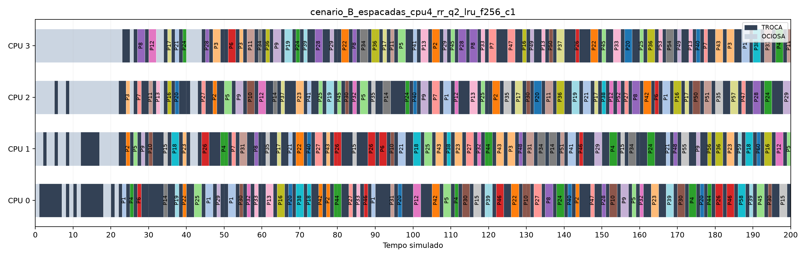

| CPU | Útil | Útil % | Troca | Troca % | Ocioso | Ocioso % | Trocas | Utilização % |
| --- | --- | --- | --- | --- | --- | --- | --- | --- |
| 0 | 10132 | 57.17 | 7436 | 41.96 | 155 | 0.87 | 7436 | 99.13 |
| 1 | 10158 | 57.32 | 7353 | 41.49 | 212 | 1.20 | 7353 | 98.80 |
| 2 | 10078 | 56.86 | 7415 | 41.84 | 230 | 1.30 | 7415 | 98.70 |
| 3 | 10030 | 56.59 | 7353 | 41.49 | 340 | 1.92 | 7353 | 98.08 |

Makespan 17723; espera média 855.18; resposta média 31.34; faults 12138; taxa 30.05%.

## B-4CPU-RR-Q50-LRU

cenario_B_espacadas_cpu4_rr_q50_lru_f256_c1

| CPU | Útil | Útil % | Troca | Troca % | Ocioso | Ocioso % | Trocas | Utilização % |
| --- | --- | --- | --- | --- | --- | --- | --- | --- |
| 0 | 10285 | 75.98 | 3143 | 23.22 | 109 | 0.81 | 3143 | 99.19 |
| 1 | 10060 | 74.31 | 3188 | 23.55 | 289 | 2.13 | 3188 | 97.87 |
| 2 | 9959 | 73.57 | 3130 | 23.12 | 448 | 3.31 | 3130 | 96.69 |
| 3 | 10094 | 74.57 | 2982 | 22.03 | 461 | 3.41 | 2982 | 96.59 |

Makespan 13537; espera média 523.81; resposta média 40.04; faults 9425; taxa 23.33%.

## B-4CPU-RR-Q5-LRU

cenario_B_espacadas_cpu4_rr_q5_lru_f256_c1

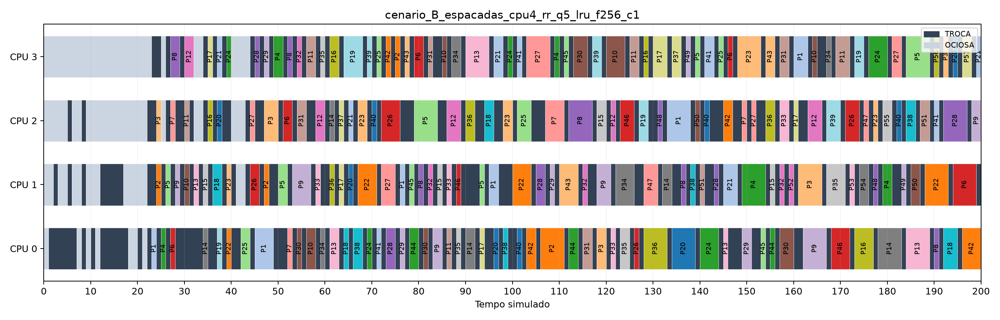

| CPU | Útil | Útil % | Troca | Troca % | Ocioso | Ocioso % | Trocas | Utilização % |
| --- | --- | --- | --- | --- | --- | --- | --- | --- |
| 0 | 10085 | 69.54 | 4166 | 28.73 | 252 | 1.74 | 4166 | 98.26 |
| 1 | 10235 | 70.57 | 4124 | 28.44 | 144 | 0.99 | 4124 | 99.01 |
| 2 | 9980 | 68.81 | 4138 | 28.53 | 385 | 2.65 | 4138 | 97.35 |
| 3 | 10098 | 69.63 | 4080 | 28.13 | 325 | 2.24 | 4080 | 97.76 |

Makespan 14503; espera média 532.82; resposta média 32.00; faults 9833; taxa 24.34%.

## B-4CPU-SJF-LRU

cenario_B_espacadas_cpu4_sjf_q0_lru_f256_c1

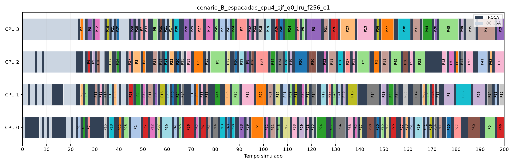

| CPU | Útil | Útil % | Troca | Troca % | Ocioso | Ocioso % | Trocas | Utilização % |
| --- | --- | --- | --- | --- | --- | --- | --- | --- |
| 0 | 10096 | 78.61 | 2532 | 19.72 | 215 | 1.67 | 2532 | 98.33 |
| 1 | 10025 | 78.06 | 2232 | 17.38 | 586 | 4.56 | 2232 | 95.44 |
| 2 | 10158 | 79.09 | 2048 | 15.95 | 637 | 4.96 | 2048 | 95.04 |
| 3 | 10119 | 78.79 | 1943 | 15.13 | 781 | 6.08 | 1943 | 93.92 |

Makespan 12843; espera média 165.36; resposta média 19.36; faults 5792; taxa 14.34%.
